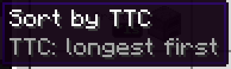

---
navigation:
  title: Сортування та кольори
  parent: features/index.md
  position: 5
---

# Сортування та кольори

План і стан крафту починають із режиму, збереженого в налаштуваннях
керування клієнта; типовий режим — **TTC: longest first**. Кнопка перемикає
порядок AE2, від найкоротшого й від найдовшого для відкритого екрана. У плані
рядки з нестачею завжди перші, а сортування діє окремо в кожній групі.
У режимах TTC невідомі оцінки йдуть після відомих у своїй групі.

Сортування стану також упорядковує список CPU: спочатку зайняті з відомим часом,
потім зайняті без оцінки, далі вільні. Порядок AE2 повертає власний список CPU.

**Кольори від швидкого до повільного** типово вимкнено. Увімкніть їх, щоб
порівнювати відомі часи всього списку; типові зелений, жовтий і червоний можна
налаштувати. Прокручування не змінює шкалу. Червоний тут означає відносно
довгий час, а не доведену затримку; для неї є окрема червона позначка
**DELAYED**. Фон значків і тінь тексту мають незалежні перемикачі.

*Тестові значення показують порядок від найдовшого та відносні кольори швидкості.*

[Назад: Діагностика затримок](delay-diagnostics.md) | [Можливості](index.md) |
[Далі: Подробиці та скидання](details-and-reset.md) | [Оцінки часу](time-estimates.md)
