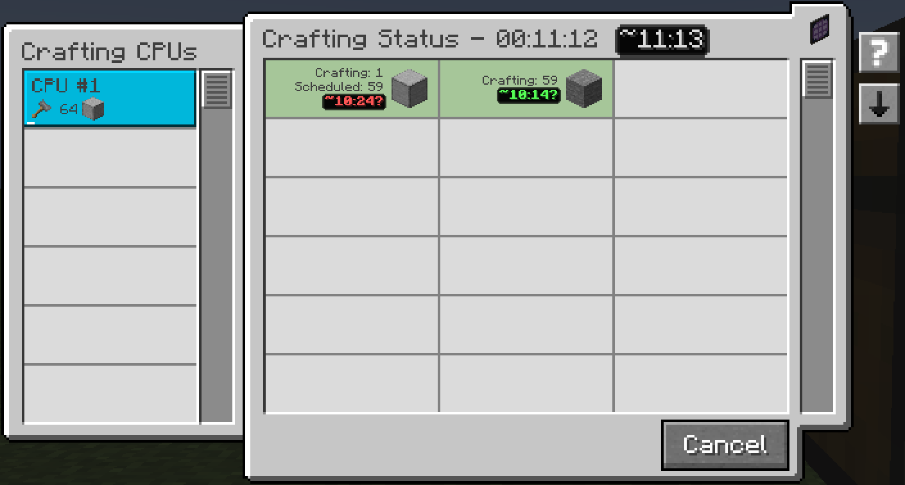

---
navigation:
  title: Learning throughput
  parent: features/index.md
  position: 1
---

# Learning throughput

Crafting Time shortens large hover rates with k, M, B, T, P and E for powers
of 1,000. For example, `~1.23M items/s` means about 1.23 million items per
second. The `~` marks a rounded value; rates beyond E use scientific notation.
Small positive rates below the display precision show `<0.01` instead of zero.
This changes only throughput text; sample durations and native AE2 quantities
keep their existing format.

The mod learns from output your AE2 network actually accepts. Each accepted
completion interval becomes a sample; returns for the same output in one tick
are combined across CPUs. Samples arrive while a large job is still running,
so you do not need to wait for the whole order to finish.

Parallel batches teach the network's combined speed. For example, accepting 64
processors over eight seconds measures roughly eight processors per second.
Other ME networks keep separate history. Items use item counts; fluids and
supported chemicals use millibuckets. New output shows No data yet until usable
timing exists. Machine changes affect later samples.

*A live job produces the outputs that become timing history as completion intervals are accepted.*

[Previous: Time estimates](time-estimates.md) | [Features](index.md) |
[Next: Confidence](confidence.md) | [Saved history](saved-history.md)
