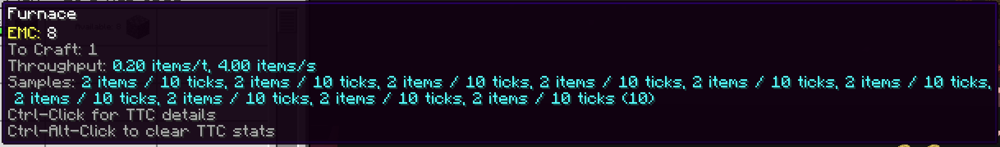

---
navigation:
  title: Saved history
  parent: features/index.md
  position: 7
---

# Saved history

Completed throughput samples are saved with the world, scoped by AE2 network
and output. Each output retains only the configured number of newest samples.
Restarting therefore does not require learning every recipe from zero.

Pending batches, live no-progress timers, recent parallel capacity and job
accuracy are runtime-only. A separate remembered-status fallback can preserve
Delayed, Waiting, No provider and No power labels until live observations
replace them; it does not restore live warning plates by itself. Missing mod
outputs can leave harmless saved entries that are not displayed. Reset removes
one output's retained history when you choose to relearn it.

*Seeded retained samples show the bounded history that survives a world save.*

[Previous: Details and reset](details-and-reset.md) | [Features](index.md) |
[Next: Configuration](configuration.md) | [Learning throughput](learning-throughput.md)
