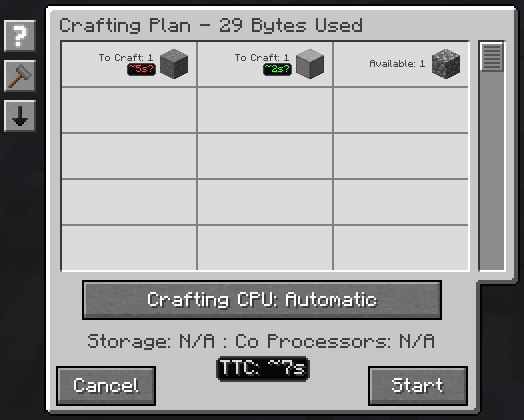

---
navigation:
  title: Time estimates
  parent: features/index.md
  position: 0
---

# Time estimates

With **Show emoji** on, each displayed time starts with ⏱. It appears
on row and total estimates, CPU cards, tooltips, samples, delayed durations,
accuracy timings, chat, and supported addon displays. Approximate and uncertain
marks remain after the symbol: `~12s?` appears as `⏱ ~12s?`. Rates and counts
stay plain. The symbol uses the game's available font; its appearance can vary
with fonts, scale, and resource packs.
In Crafting Plan and Crafting Status rows, symbols match the text color. The
Crafting Plan total uses the same foreground as the CPU details above it without
a badge, or the light Total color with a badge. Other
screens keep the symbol colors described in the status chapter.
Without a badge background, Waiting, collecting data, Stored variant, and other
neutral row text use AE2's text color. With a badge, they use the light Total
color. Red warnings and optional fast-to-slow TTC colors keep their colors.
Tooltips keep their existing colors.

Crafting Plan shows TTC beside every row that has learned timing data. The row
time covers the full **To Craft** amount, not one pattern operation. The total
below the CPU details adds the known plan rows; if some rows have no data, it is
only the known part of the job.

Times below one second use milliseconds: `50ms`, `500ms`, or `5ms` at the
minimum. Fractional milliseconds round up for display. Samples and average/latest
timings also use ms instead of ticks; one simulation tick is 50ms.

Reliable TTC of 5ms or less shows the green `🥇 Instant` status. Low confidence
shows `5ms?` instead. Under **Options > Client > Displays**, **Instant status**
starts on; turn it off for numeric time. **Show emoji** hides only the medal.
Each chat recipient uses their own settings. Partial totals keep a question mark
and never show Instant when any remaining row is unknown or unreliable.

With **Compact crafting amounts** on, the plan shows available and to-craft
amounts on one line: `4/10`. With only one amount, `A4` means available and
`C10` means to craft. Missing and
recurrent warnings stay separate. Hover for AE2's full labeled amounts.

Crafting Status uses the same row estimates while a job runs. Its total follows
the longest remaining dependency path, so parallel branches are not added as if
they ran one after another. For example, two independent ten-second branches
can still finish in about ten seconds, while two dependent steps take about
twenty. Estimates are not deadlines: machine speed, other work, and server load
can change the result.
When a total is known, the title shows `TTC: ⏱ ...` in the normal title color
instead of AE2's elapsed estimate. Without a known total, it shows the normal
CPU name. The red storage warning still appears when needed. Turn off
**Crafting Status total** to use AE2's original title.

At GUI scale 1, Crafting Plan and Crafting Status use one wider column so row
text stays readable. Fewer rows fit at once; scroll to reach the rest. A line
that is too long for its cell shows an ellipsis, with the full line on hover.
CPU-card TTC also uses full-size text at scale 1. If its preview ends in an
ellipsis, hover the card for the complete estimate. Other GUI scales keep their
usual layout. The row and CPU-card display options control these corrections.

With the same option on, Crafting Status puts available, crafting, and scheduled
amounts on one line, in that order: `4/10/200`. A missing amount is `-`; when only one amount is
present, its `A`, `C`, or `S` prefix identifies it. Hover for AE2's full labeled
amounts. **Compact crafting amounts** starts off under **Options > Client >
Displays**. Turn it on for the compact line in both windows. This setting works
independently of row TTC.

*Seeded test values show two learned recipe estimates and their known total.*

[Features](index.md) | [Next: Learning throughput](learning-throughput.md) |
[Make your first estimate](../getting-started.md)
